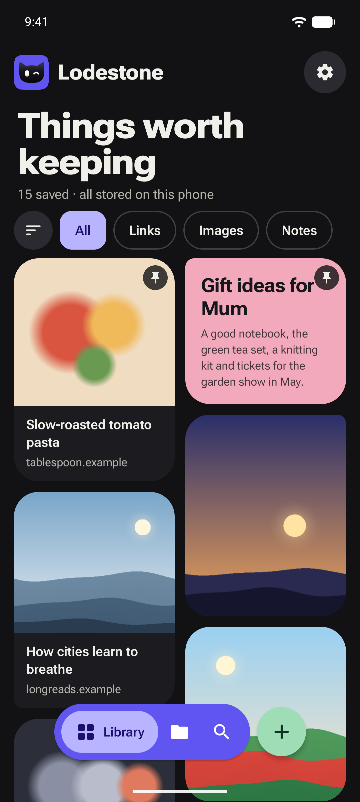
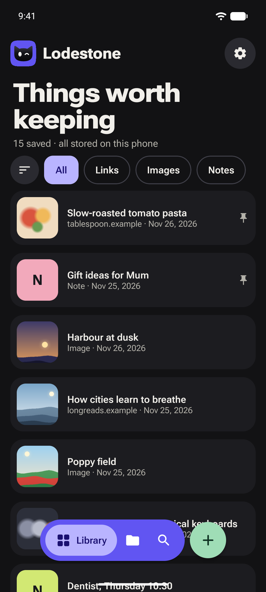
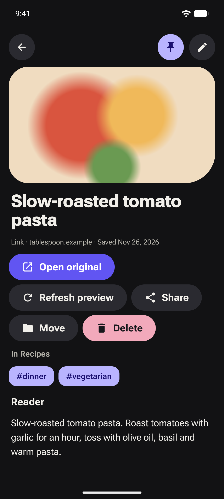
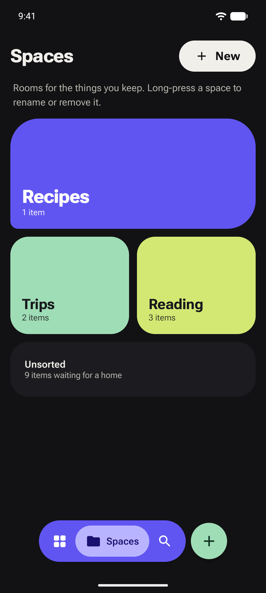
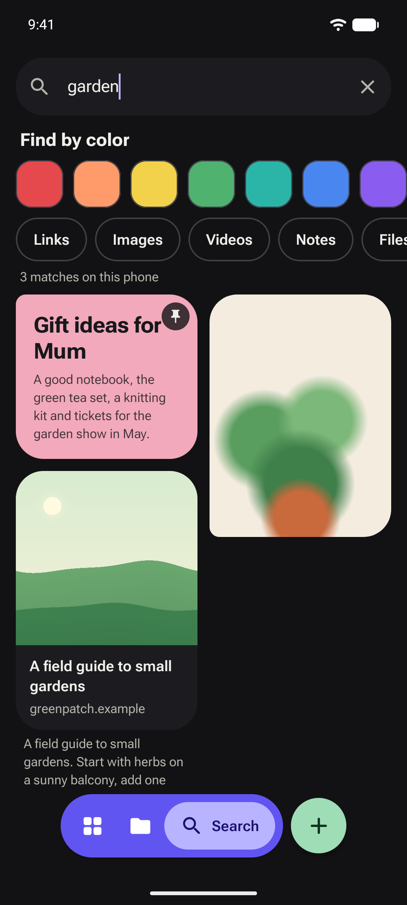
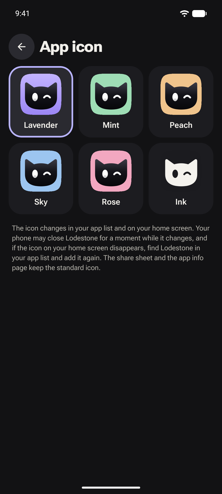
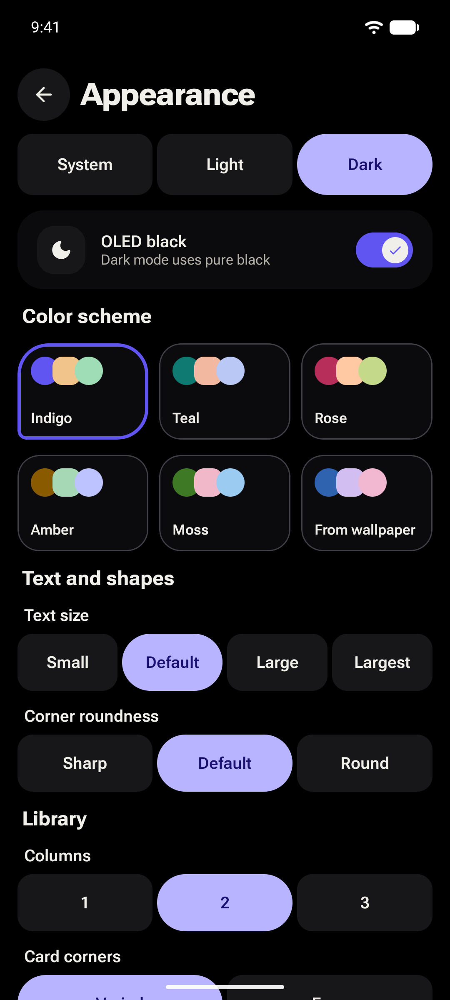
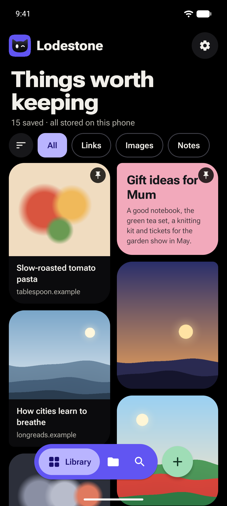
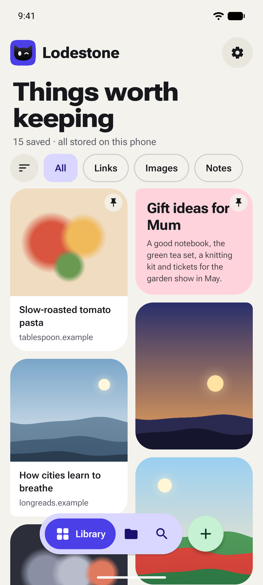

# Lodestone

A calm, private place to keep links, pictures, videos, files and notes, on your own phone.
No account, no cloud, no analytics, no ads. Inspired by mymind, designed in Material 3 Expressive.

Android 8.0 or newer (API 26). Licensed under the [MIT licence](LICENSE).

## Screenshots

All screenshots use invented sample data: the titles, sites and pictures were made up for this page.

| Library | List view | An item |
|:--:|:--:|:--:|
|  |  |  |

| Spaces | Search | App icons |
|:--:|:--:|:--:|
|  |  |  |

| Appearance | OLED black | Light |
|:--:|:--:|:--:|
|  |  |  |

## What it does

- **Local and offline.** Everything lives in the app's private storage on your phone.
- **Share into it.** Share a link, text, photo, video or file from any app and "Save to Lodestone" keeps it without leaving the app you were in. Settings → Share sheet can switch this to ask first.
- **Links that work offline.** Saving needs no connection. The title, preview picture and a readable copy are fetched when you are online. Posts from YouTube, Instagram and other platforms play inside the app when you tap them.
- **Find things.** Search words, tags, page text and the words inside pictures and PDFs (read on the phone with Tesseract). Filter by type or colour.
- **Keep it tidy.** Spaces, Smart Spaces with rules, tags, pinning, sorting (newest, oldest, title, site), cards or a compact list, multi-select, and Undo after a delete. Deleted items wait 30 days in Recently deleted.
- **Your data is yours.** One-file backup and restore. Import browser bookmarks, or a mymind export (the exported folder, a zip of it, or its `cards.csv`).
- **Make it yours.** Light, dark or system, OLED black, six colour schemes, text size, corner roundness, grid columns, motion and haptics, and a choice of six app icons.

Not built yet: reading handwriting, links between notes, summaries written by an AI, app lock. See [CHANGELOG.md](CHANGELOG.md).

## Privacy

Lodestone has no server and no analytics. It goes online only to fetch the page of a link you saved or imported, to ask the link's platform (for example YouTube, X, Bluesky, Vimeo, Instagram) for the post's title and picture, and to play a post when you tap it. There is no Lodestone server in between. Read [PRIVACY.md](PRIVACY.md).

## Install

- **F-Droid:** submission is prepared in [`fdroid/`](fdroid/rykode.lodestone.yml). Once listed, install it from the F-Droid app.
- **GitHub:** download the APK from the [latest release](https://github.com/Rykode/Lodestone/releases/latest), open it on your phone and allow "install unknown apps" for the app you opened it from.

The F-Droid build and the GitHub APK are signed with different keys, so Android will not update one over the other. Pick one source and stay with it. Back up before switching (Settings → Back up & import).

## Build

You need JDK 21 and the Android SDK with platform `android-37.1` and build-tools 36.

```powershell
./gradlew testDebugUnitTest      # unit tests
./gradlew assembleDebug          # app/build/outputs/apk/debug/app-debug.apk
./gradlew assembleRelease        # signed only if a signing file exists, see below
```

### Signing a release

The release build reads `keystore.properties` (`storeFile`, `storePassword`, `keyAlias`, `keyPassword`) from the folder in the `LODESTONE_SIGNING_DIR` environment variable, or `~/.lodestone-signing` when it is not set. Without that file the release APK is unsigned. Keep the keystore outside the repository and back it up: if you lose it you can never publish an update that installs over the old version.

## Project layout

- `app/src/main/java/app/lodestone/data/` SQLite store, link and media ingestion, embeds, text reading (OCR), backup and import
- `app/src/main/java/app/lodestone/ui/` screens, components, theme, expressive shapes
- `fastlane/metadata/android/` store listing text for F-Droid
- `fdroid/` draft F-Droid build recipe

The Kotlin package is `app.lodestone`. The Android application id is `rykode.lodestone`.

## Credits

See [NOTICE.md](NOTICE.md) for the open-source components Lodestone includes.
